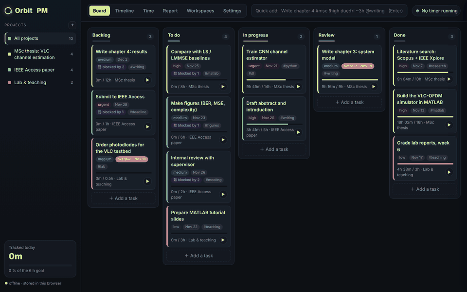
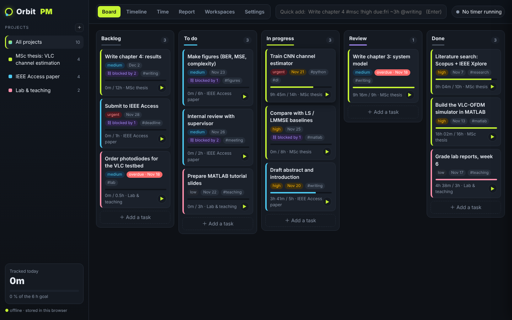
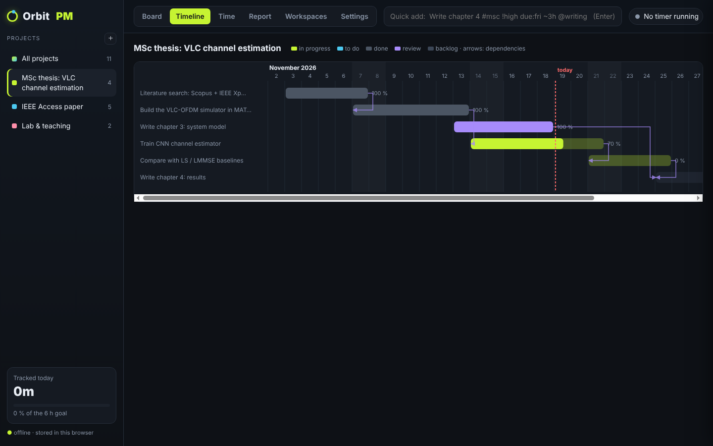
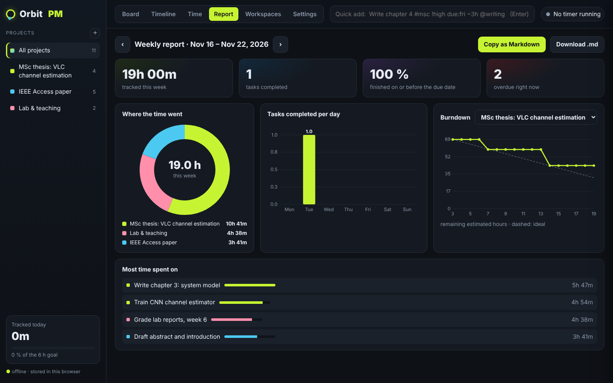
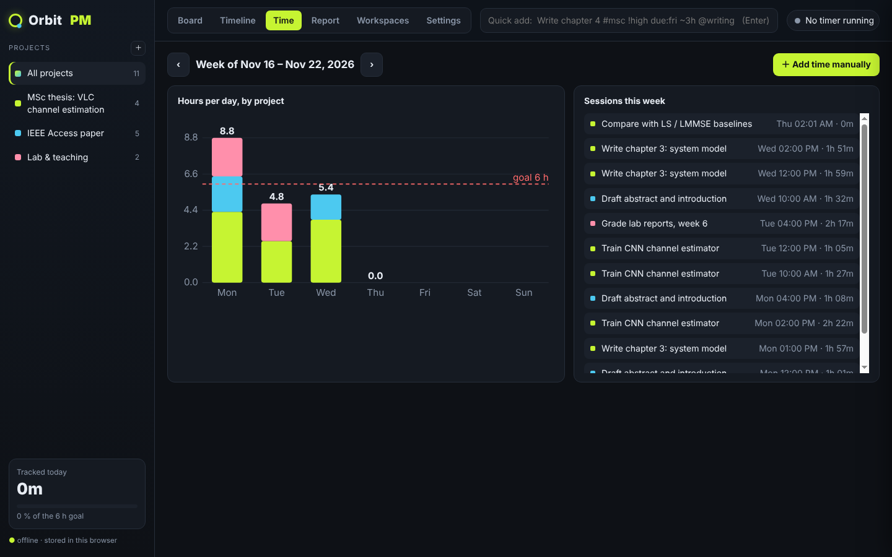
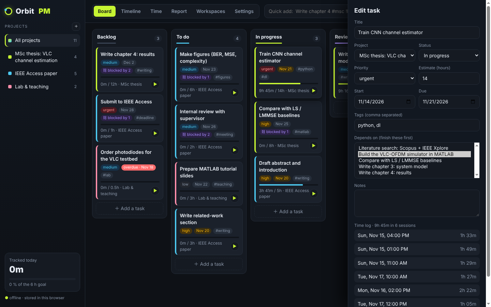
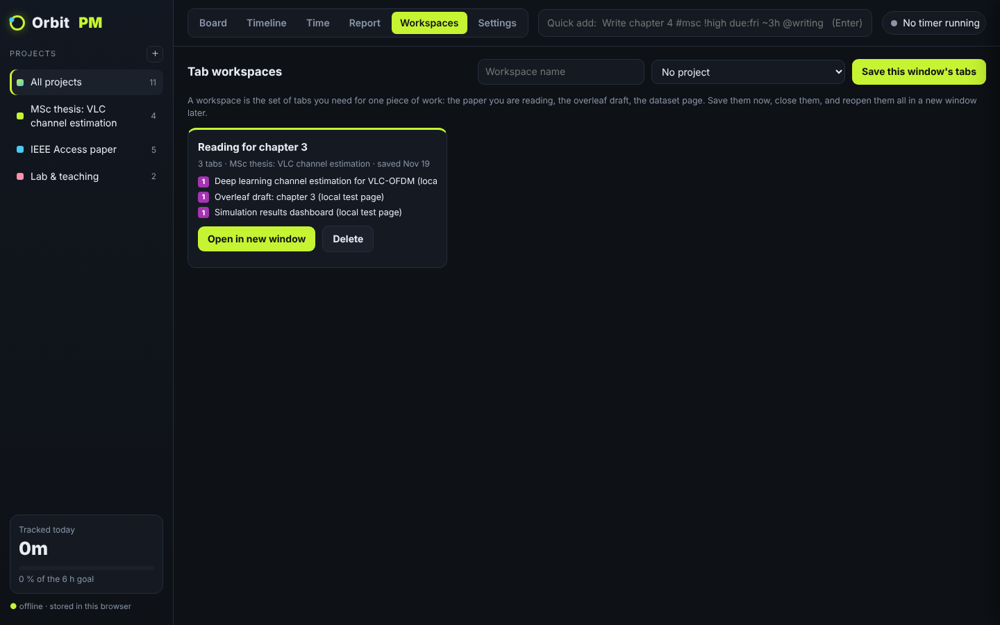
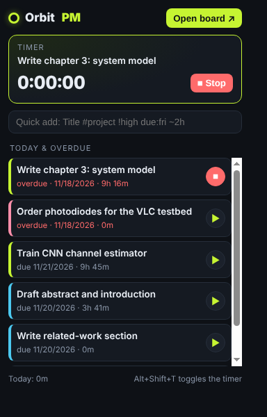
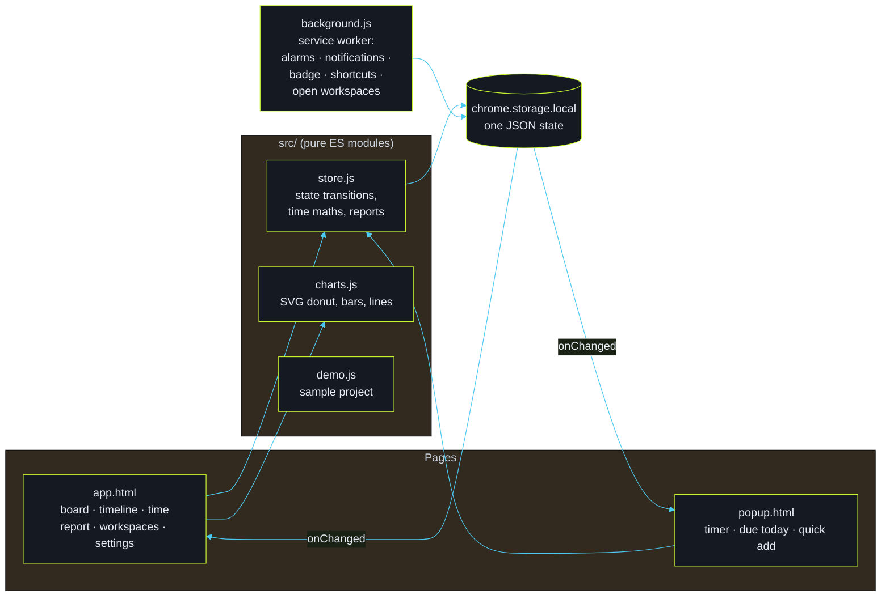

<p align="center"></p>

<p align="center">


</p>

<h3 align="center">Kanban board, Gantt timeline, a timer on every task, tab workspaces, deadline reminders and a weekly report.<br>All inside Chrome, offline, with no account and no server.</h3>

**Orbit PM** is a project manager for people whose work happens in the browser: students writing a thesis, researchers juggling a paper and a lab, freelancers with three clients. It is a Chrome extension written from scratch in plain JavaScript (no framework, no library, nothing loaded from the internet), and every byte of your data stays in `chrome.storage.local` on your computer.

<p align="center"></p>
<p align="center"><sub>The tour above is the end-to-end test: real Chromium, the real unpacked extension, driven by Playwright. Each frame is a screenshot the test takes after checking the stored state.</sub></p>

---

## ◎ What it does

| | |
|:--|:--|
| **Kanban board** | Five columns (Backlog, To do, In progress, Review, Done), drag and drop with position, colour per project, priority and due-date chips, tags, "blocked by" badges, an estimate-vs-logged progress bar on every card. |
| **Gantt timeline** | Start and due dates as bars, progress filled from the time you logged against the estimate, dependency arrows, weekends shaded, a red line for today. Per project or all together. |
| **Time tracking** | ▶ on any card starts a timer (starting one stops the other and logs it). The toolbar badge shows the running minutes; `Alt+Shift+T` stops it or restarts the last task. Manual entries for work done away from the computer. |
| **Tab workspaces** | Save the tabs of the current window (papers, Overleaf, dashboards) under a project, close them, and reopen all of them in a new window later. |
| **Deadlines** | Chips turn amber the day before and red when overdue; a notification arrives 24 h before a deadline (checked every 30 minutes with `chrome.alarms`). |
| **Weekly report** | Hours tracked, tasks completed, on-time rate, overdue tasks, a donut of time per project, tasks completed per day, a burndown per project, the five tasks that took most time. Copy it as Markdown or download it. |
| **Popup** | The running timer, what is due today or overdue with one-click timers, and quick add, without leaving the page you are on. |
| **Quick add** | `Write chapter 4 #thesis !high due:fri ~3h @writing` → title, project, priority, due date, estimate and tag in one line. |
| **Your data** | Export and import JSON (validated before replacing anything); a sample project to explore; delete everything with one button. |

## ◎ Screenshots

<table>
<tr><td><p align="center"><sub><b>Board</b> · all projects, a card just dragged into In progress</sub></p></td>
<td><p align="center"><sub><b>Timeline</b> · progress from logged time, dependency arrows, today line</sub></p></td></tr>
<tr><td><p align="center"><sub><b>Weekly report</b> · KPIs, time per project, burndown, top tasks</sub></p></td>
<td><p align="center"><sub><b>Time</b> · hours per day stacked by project against the daily goal</sub></p></td></tr>
<tr><td><p align="center"><sub><b>Task editor</b> · dates, estimate, dependencies, time log</sub></p></td>
<td><p align="center"><sub><b>Workspaces</b> · the open tabs saved under a project</sub></p></td></tr>
</table>

<p align="center"></p>
<p align="center"><sub><b>Popup</b> · running timer, due and overdue tasks, quick add</sub></p>

The data in the screenshots is the built-in sample project (Settings → Load sample data), with dates relative to the day it is loaded.

## ◎ Install

1. Download this repository (Code → Download ZIP) and unzip it, or `git clone` it.
2. Open `chrome://extensions`, switch on **Developer mode** (top right).
3. Click **Load unpacked** and select the folder that contains `manifest.json`.
4. Pin Orbit PM to the toolbar. Click it, then **Open board**.

Works in Chrome, Edge, Brave and other Chromium browsers (Manifest V3). Nothing to build: the extension runs the files in this folder as they are.

### Keyboard

| Key | Where | Action |
|:--|:--|:--|
| `Alt+Shift+O` | anywhere | open the popup |
| `Alt+Shift+T` | anywhere | stop the timer, or restart the last task |
| `n` | board | new task |
| `/` | board | focus quick add |
| `1` … `5` | board | Board, Timeline, Time, Report, Workspaces |
| `Esc` | editor | close |

### Quick-add syntax

| Token | Meaning | Example |
|:--|:--|:--|
| `#name` | project (prefix of its name, spaces as dashes) | `#ieee`, `#msc-thesis` |
| `!level` | priority: low, medium, high, urgent | `!urgent` |
| `due:when` | `today`, `tomorrow`, a weekday, or `2026-12-01` | `due:fri` |
| `~Nh` | estimate in hours | `~2.5h` |
| `@tag` | tag (any number) | `@writing @matlab` |

## ◎ How it is built



* **One state object, pure functions.** Every change (`moveTask`, `startTimer`, `addDependency`, ...) takes the state and returns a new one; the pages save it and re-render. The same functions run in Node for the unit tests.
* **Time is stored as sessions** (`{start, end}` in milliseconds) on each task, so any report is a sum over clipped intervals: hours this week, per day, per project, all from the same `loggedMs`.
* **One timer at a time.** Starting a timer stops and logs the running one; a task in Backlog or To do moves to In progress when you start it.
* **Dependencies are a directed graph**; adding one that would close a cycle is refused.
* **Charts are SVG strings** generated by 80 lines in `charts.js`, styled with CSS. Extension pages may not load scripts from the internet, and none are needed.
* **Pages stay in sync**: the popup, the board and the service worker all listen to `chrome.storage.onChanged`, so a timer started from the popup appears on the open board immediately.

### Permissions, and why

| Permission | Used for |
|:--|:--|
| `storage`, `unlimitedStorage` | your projects, tasks and time logs |
| `alarms` | the deadline check every 30 minutes and the badge every minute |
| `notifications` | "due within 24 h" and "overdue" reminders |
| `tabs` | reading the current window's tab titles and addresses to save a workspace, and opening them again |

No host permissions, no content scripts, no network access. The extension never sends anything anywhere.

## ◎ Tests

```bash
npm test                       # 13 unit tests of the state logic and charts (Node 18+)
npm run e2e                    # end-to-end in real Chromium (Python + Playwright, xvfb on a server)
```

**Unit tests** ([`test/store.test.js`](test/store.test.js)) check that updates never mutate their input; card moves renumber both columns and stamp completion dates; switching timers logs the previous session; time is clipped to report windows correctly; dependency cycles are refused; deleting a task cleans dependencies and the timer; due-date states; the quick-add parser; that the weekly report's per-day hours add up to its total; that the burndown never rises; Gantt ordering; workspace filtering and import validation; and that the charts produce SVG.

**End-to-end** ([`scripts/e2e.py`](scripts/e2e.py)) loads the unpacked extension into Chromium and checks, against the stored state after each step ([`results/e2e.json`](results/e2e.json)):

| # | Check | Result |
|--:|:--|:--|
| 1 | service worker starts | ✅ |
| 2 | sample data loads | ✅ 3 projects, 13 tasks |
| 3 | board shows every task | ✅ 13 cards |
| 4 | drag and drop moves a card to another column | ✅ |
| 5 | ▶ starts a timer on that task | ✅ |
| 6 | ■ stops it and logs one session of the right length | ✅ ≈ 2.5 s |
| 7 | quick add parses project, priority, estimate and tag | ✅ |
| 8 | timeline draws bars and dependency arrows | ✅ 12 bars, 5 arrows |
| 9 | report shows the four KPIs | ✅ |
| 10 | weekly report exports Markdown | ✅ [example](results/weekly-report-example.md) |
| 11 | workspace saves the open web tabs | ✅ 3 tabs |
| 12 | workspace reopens them in a new window | ✅ 3 new tabs |
| 13 | the popup starts a timer | ✅ |

The three tabs used for the workspace test are local pages from [`test/fixtures/`](test/fixtures) served on 127.0.0.1.

## ◎ Repository map

```
chrome-project-manager/
├── manifest.json          Manifest V3
├── background.js          service worker: alarms, notifications, badge, shortcuts, workspaces
├── app.html               the full app (opened in a tab)
├── popup.html             the toolbar popup
├── src/
│   ├── store.js           data model and every state transition (pure)
│   ├── charts.js          SVG charts
│   ├── storage.js         chrome.storage.local (localStorage outside the extension)
│   ├── demo.js            sample projects
│   ├── app.js, app.css    the app UI
│   └── popup.js, popup.css
├── icons/                 16, 32, 48, 128 px
├── test/                  unit tests (node --test) and e2e fixtures
├── scripts/e2e.py         Playwright end-to-end test and screenshots
├── results/               screenshots, e2e.json, example weekly report
└── assets/                hero.svg, demo.gif
```

## ◎ Roadmap

- Sync between your own computers through `chrome.storage.sync` (it has a 100 KB quota, so time logs would need compaction).
- Recurring tasks and subtasks.
- iCalendar export of deadlines.
- A side-panel version of the board.

## ◎ Licence

MIT © Eng. Jaafar Salim
